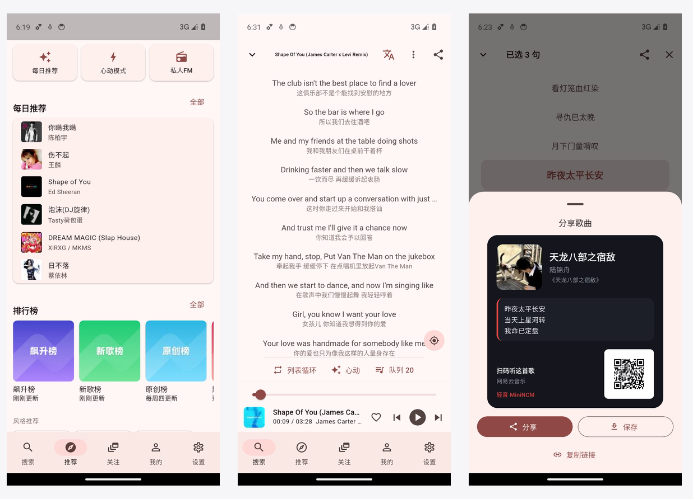
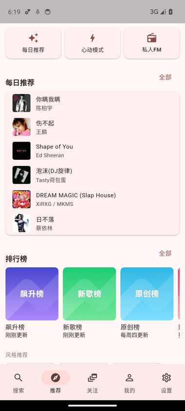
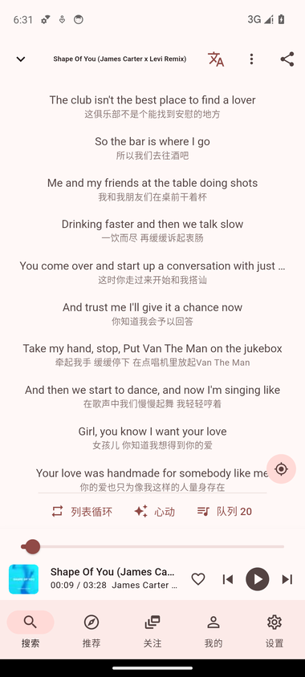
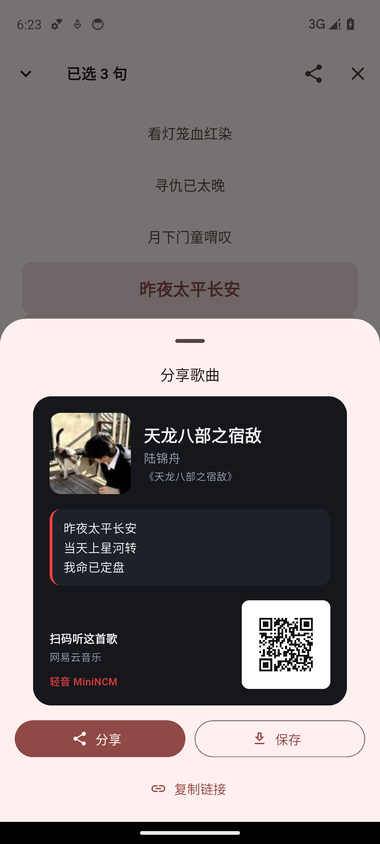
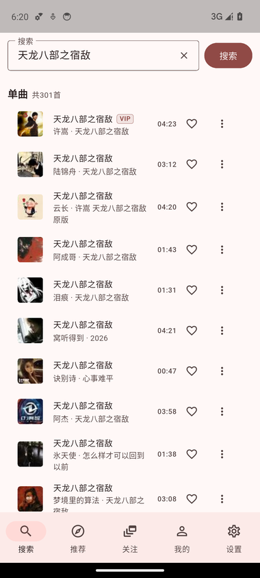
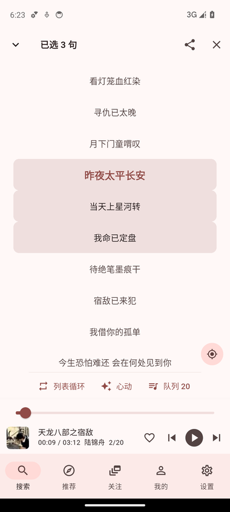
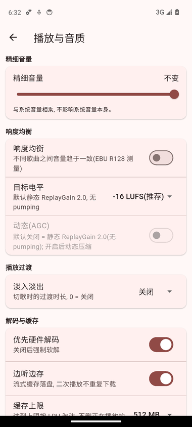
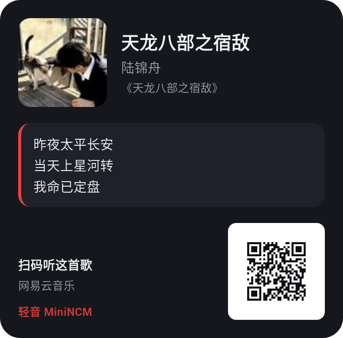

<div align="center">

# MiniNCM · 轻音

**An unofficial NetEase Cloud Music client — Android · Linux · Windows**

[中文](README.md) · **English**

Rust core (protocol / identity / cache / playback) + Flutter UI (one codebase, three platforms)
+ platform layer (Android Media3 / Linux·Windows rodio+CPAL)

[](https://flutter.dev)
[](https://www.rust-lang.org)
[](#)
[](#)
[](https://github.com/xiaquwan1001/netease-mini-player/actions/workflows/windows.yml)
[](https://github.com/xiaquwan1001/netease-mini-player/actions/workflows/ci.yml)
[](LICENSE)
[](#build--test)



</div>

## What is this

A deliberately small, long-lived NetEase Cloud Music client: a **one-row** player bar, tap it and you land on
lyrics; no recommendation spam. Protocol, crypto, anti-bot and identity live in Rust — the UI only has to look good.

- **One UI, three platforms** — the same Dart code builds an Android APK, a Linux desktop bundle and a
  Windows x64 app; platform differences are confined to `playback.dart` / `platform.dart` and two `cfg` playback backends.
- **No home-made protocol** — crypto / request shapes come from `core/vendor/ncm-api` (a Rust port of
  *api-enhanced*, pinned commit). We add identity injection, DTO conversion and caching.
- **Identity discipline** — `device_id` is generated once and reused forever; device cookies
  (`_ntes_nuid/_ntes_nnid/NMTID/WNMCID`) are persisted (0600) instead of being randomised per process.

## Screens

<table>
<tr>
<td width="33%"></td>
<td width="33%"></td>
<td width="33%"></td>
</tr>
<tr>
<td align="center">Daily picks / charts / styles</td>
<td align="center">Song detail: synced lyrics + translation toggle</td>
<td align="center">Select lyrics → share card</td>
</tr>
<tr>
<td width="33%"></td>
<td width="33%"></td>
<td width="33%"></td>
</tr>
<tr>
<td align="center">Search: songs / playlists / podcasts</td>
<td align="center">Long-press lyrics → multi-select</td>
<td align="center">Loudness normalisation / AutoEQ</td>
</tr>
</table>

### Share card

Long-press a lyric line, select a few, hit **Share selected lyrics** — you get a card with cover art,
lyrics and a QR code pointing at the official song page (`music.163.com/song?id=...`):



## Features

| Area | What works |
|---|---|
| Playback | One-row player bar, queue (jump / drag-reorder / clear / save as playlist), play modes, MV playback (embedded VideoView on Android / system player on desktop), stream cache with LRU limit |
| Lyrics | Synced highlight, word-by-word lyrics (yrc + AMLL TTML dual source with auto scoring), translation toggle, lyric multi-select → share card, cover-colour backdrop |
| Playlists | Playlist square & charts, subscribe / create / edit / delete, batch add, liked-songs ordering, recent-play four tabs |
| Community | Comments (hot / all / replies / like / delete / IP location), private messages & mentions (read-only), follows feed, follow/fan lists, sign-in |
| Desktop | Linux (deb/AppImage/tar.gz) and Windows (setup.exe/zip) share one rodio backend (ALSA/WASAPI), OLED pure-black theme, fine volume -40..0 dB |
| VIP (read-only) | VIP card / growth / weekly sign-in / tasks, purchased digital albums (no payments) |
| Search & discover | Search (history / suggestions / hot queries / typed sections), daily picks, personal FM, heart mode, new songs & albums by region, style picks |
| Audio quality | Loudness normalisation (EBU R128 + ReplayGain 2.0), AutoEQ curve import (PK·LS·HS), fade in/out, hardware/software decode, cover quality presets |

## Architecture

```text
+---------------- Flutter UI (ui/, shared) ----------------+
|  pages / widgets - player bar - song detail - share card  |
+-----------+----------------------------------+------------+
            | flutter_rust_bridge 2.13          | ncm/player (MethodChannel)
+-----------v---------------+      +-----------v------------+
| Rust core (core/)          |      | Android platform layer |
|  ncm-domain    models      |      |  Media3 ExoPlayer      |
|  ncm-provider  abstraction |      |  MediaSessionService   |
|  ncm-service   identity    |      |  login WebView / share |
|  ncm-ffi       FRB bridge  |      +------------------------+
|  ncm-cli       headless    |      +------------------------+
|  vendor/ncm-api protocol   |      | Linux layer (pure Rust)|
+----------------------------+      |  rodio + CPAL + symphonia |
                                    +------------------------+
```

- Only serialisable `ncm-domain` types cross the FFI boundary; provider errors are normalised to
  `ProviderError{kind, retryable, detail}` and the UI branches on `kind`.
- Linux and Windows builds have **no system player dependency** (no mpv / MPRIS) — same rodio backend,
  ALSA on Linux and WASAPI on Windows: unzip and run (`bundle/minincm`, `minincm.exe`).

## Build & run

```bash
git clone https://github.com/xiaquwan1001/netease-mini-player.git
cd netease-mini-player
source tools/env.sh          # JDK 21 / Flutter / Android SDK / Rust (edit for your machine)

bash tools/build-linux.sh    # -> ui/build/linux/x64/debug/bundle/minincm
bash tools/build-android.sh  # -> ui/build/app/outputs/flutter-apk/app-debug.apk
bash tools/ci.sh             # tests + bridge smoke + Linux/Android builds
```

Desktop packages (local scripts in [`packaging/`](packaging/)):

```bash
bash packaging/linux/build-deb.sh        # -> dist/minincm_<ver>_amd64.deb
bash packaging/linux/build-appimage.sh   # -> dist/MiniNCM-<ver>-linux-x86_64.AppImage
# Windows installer (Inno Setup), on Windows: iscc /DAppVersion=<ver> /Odist packaging\windows\installer.iss
```

Every tagged release ships via [**GitHub Releases**](https://github.com/xiaquwan1001/netease-mini-player/releases/latest):
APK (arm64) · Linux tar.gz · `.deb` · AppImage · Windows `setup.exe` · Windows portable zip · `SHA256SUMS.txt`
(v0.3.2 measured: APK 28.5 MB / tar.gz 15.0 MB / AppImage 14.6 MB / deb 11.1 MB / Windows zip 17.0 MB / setup.exe 13.7 MB).

Windows desktop **must be built on Windows** (Flutter desktop does not cross-compile), so there is no local
script: [`.github/workflows/windows.yml`](.github/workflows/windows.yml) produces
`MiniNCM-<version>-windows-x64.zip` (~17 MB, verified) on `windows-latest`. Locally on Windows:
`flutter config --enable-windows-desktop` then `flutter build windows --release` (cargokit builds the Rust `ncm_ffi`).

Headless verification (no UI):

```bash
cd core
cargo run -p ncm-cli -- search "shape of you" --limit 5
cargo run -p ncm-cli -- url 186016 --download /tmp/a.mp3
cargo run -p ncm-cli -- lyric 186016
```

## Build & test gates

| Gate | Status |
|---|---|
| `cargo test --offline --workspace` | **254** passing (230 when the vendor crate is excluded) |
| `flutter test --exclude-tags network` | **570** passing (offline subset; real-network smoke tests are tagged `@Tags(['network'])`, excluded locally and in CI) |
| `dart analyze` | 0 error / 0 warning (41 info hints) |
| Builds | Linux bundle + Android APK locally; Windows x64 zip via `windows.yml` CI |
| Device run-through | emulators a34/a36 (API 34/36) + real-device listening checks — see `docs/testing-dual-platform.md` |

## Roadmap

| Stage | Content | Status |
|---|---|---|
| M0 | Rust workspace layering, provider abstraction, headless CLI | done |
| Protocol | vendored port + prune (382 -> 118 endpoints, 123 now covered, 12k -> 4k LOC) | done |
| Shell | Flutter Android/Linux/Windows, FRB 2.13 bridge, all builds (Windows via CI) | done |
| Playback | Media3 (Android) / rodio (Linux ALSA · Windows WASAPI), loudness, AutoEQ, cache | done |
| UI | 5-tab IA, recommend/search/follows/mine/settings, one-row player bar, song detail, share card | done |
| Real-device checks | listening items (EQ clipping / fade feel / loudness A/B / hardware decoding) and MV playback passed on a real device on 2026-11-10 | done |
| TODO | pluggable audio sources, refactor debt, phone-SMS login real-device check — see [`docs/remaining-batches.md`](docs/remaining-batches.md) §11 | planned |

See `docs/PROGRESS.md` (Chinese) for the per-batch evidence.

## Docs (mostly Chinese)

| Doc | Content |
|---|---|
| [`docs/PROGRESS.md`](docs/PROGRESS.md) | progress log with acceptance evidence |
| [`docs/architecture-restart.md`](docs/architecture-restart.md) | architecture decisions, plugin boundaries |
| [`docs/archive/ui-song-detail-share.md`](docs/archive/ui-song-detail-share.md) | player bar merge / song detail / share card & channel contract |
| [`docs/testing-dual-platform.md`](docs/testing-dual-platform.md) | dual-platform testing, semantics-driven automation, gotchas |
| [`docs/api-channel.md`](docs/api-channel.md) | API channel (interface / interface3) measurements |
| [`docs/remaining-batches.md`](docs/remaining-batches.md) | backlog & batching plan (latest in §11) |
| [`packaging/`](packaging/) | deb / AppImage / Windows installer scripts |
| [`tools/devui/`](tools/devui/README.md) | headless emulator automation helpers |

## License

MIT — see [LICENSE](LICENSE). Third-party components and their licences (WTFPL / MIT / MPL-2.0 / BSD-3-Clause)
are listed in [THIRD_PARTY_NOTICES.md](THIRD_PARTY_NOTICES.md).

## Disclaimer

For study and research only — please support the official service. This project ships no audio content:
stream URLs are resolved on demand. Your login state stays on your device (0600 file) and is never uploaded.
