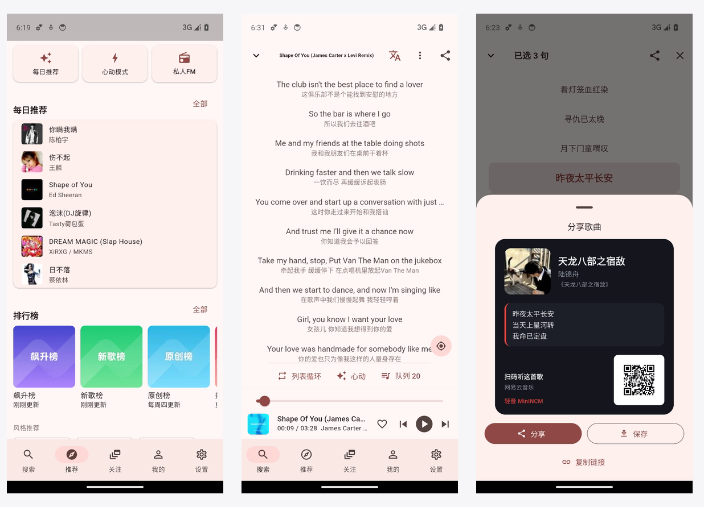
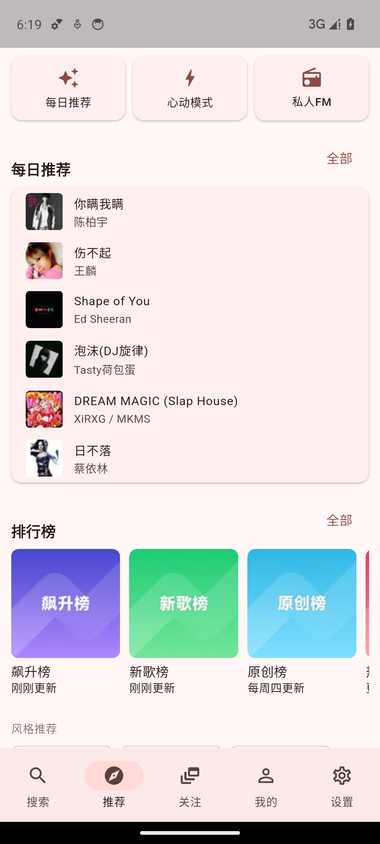
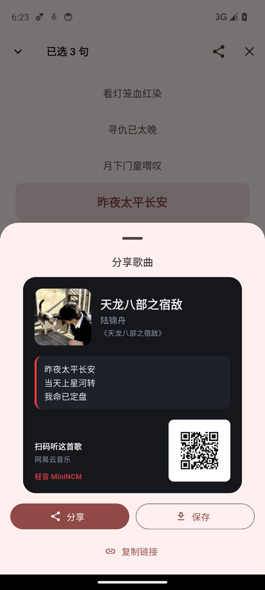
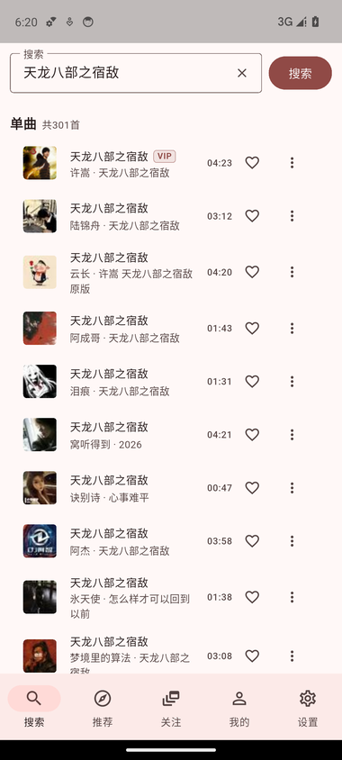
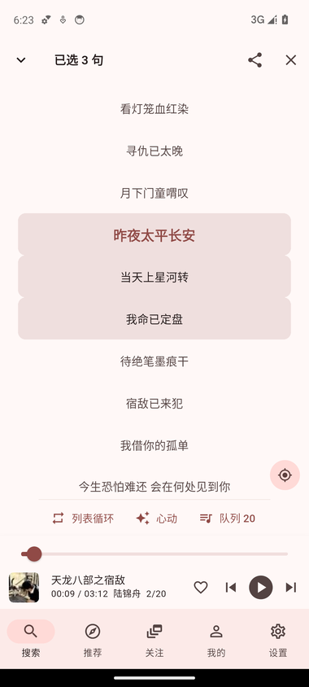
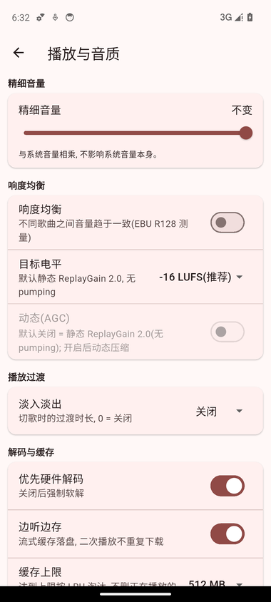

<div align="center">

# 轻音 MiniNCM

**网易云音乐第三方客户端 · Android · Linux · Windows**

[**中文**](README.md) · [English](README.en.md)

Rust core(协议/身份/缓存/播放) + Flutter UI(一份代码跑三端) + 平台层(Android Media3 / Linux·Windows rodio+CPAL)

[](https://flutter.dev)
[](https://www.rust-lang.org)
[](#)
[](#)
[](https://github.com/xiaquwan1001/netease-mini-player/actions/workflows/windows.yml)
[](https://github.com/xiaquwan1001/netease-mini-player/actions/workflows/ci.yml)
[](LICENSE)
[](#测试与门禁)



</div>

## 这是什么

一个**极简、可长期维护**的网易云音乐客户端:播放条只有一行、点开就是歌词详情页,
不喜欢的歌一律不推;协议、加解密、风控与身份都在 Rust 里,UI 只负责"好看好用"。

- **一份 UI 跑两个平台**:`ui/` 的 Dart 代码同时构建 Android APK 与 Linux 桌面;
  平台差异只出现在 `playback.dart` / `platform.dart` 两个文件。
- **协议不自研**:加解密/风控/接口形态全部来自 `core/vendor/ncm-api`(api-enhanced 的 Rust 移植,
  锁定 commit),我们只做身份注入、DTO 转换与缓存。
- **身份纪律**:`device_id` 首启生成后永久复用,设备 cookie(`_ntes_nuid/_ntes_nnid/NMTID/WNMCID`)
  落盘 0600,禁止每进程随机 —— 少一次"莫名其妙被风控"。

## 界面

<table>
<tr>
<td width="33%"></td>
<td width="33%"></td>
<td width="33%"></td>
</tr>
<tr>
<td align="center">推荐:每日推荐 / 排行榜 / 风格</td>
<td align="center">歌曲详情页:逐行歌词 + 翻译开关</td>
<td align="center">歌词多选 → 分享卡片</td>
</tr>
<tr>
<td width="33%"></td>
<td width="33%"></td>
<td width="33%"></td>
</tr>
<tr>
<td align="center">搜索:单曲/歌单/播客分类</td>
<td align="center">长按歌词 → 多选</td>
<td align="center">播放与音质:响度均衡 / AutoEQ</td>
</tr>
</table>

### 分享卡片

歌词长按进多选,选中后右上角「分享所选歌词」→ 生成带封面、歌词与二维码的卡片
(二维码指向官方网页,任何扫码器可打开),可系统分享或存图库:


## 功能一览

| 模块 | 已实现 |
|---|---|
| 发现 | 搜索(历史/联想/热词榜)、每日推荐(歌曲·歌单·播客)、每日私人 FM、心动模式、排行榜、新碟上架、风格推荐、关注动态、私信与评论 |
| 播放 | 播放条(一行)、播放队列(可跳可删)、播放模式、歌曲详情页(歌词/翻译/多选分享/定位当前句)、逐字歌词 |
| 播放质量 | 精细音量(-40..0 dB)、响度均衡(EBU R128/BS.1770-4 测量 + ReplayGain 2.0 静态增益,可选动态 AGC ≤3 dB/s)、AutoEQ 曲线导入(PK·LS·HS)、淡入淡出、优先硬解/仅软解、边听边存 + 缓存上限 LRU |
| 账号 | 网页登录(Android WebView,只回传 cookie)、多账号账号簿、我喜欢/歌单/播客/关注 |
| 外观 | 主题(浅色/深色/OLED 纯黑)、界面字号、推荐卡片一排/两排 |

## 架构

```text
┌─────────────── Flutter UI(ui/, 一份 UI 跑三端)───────────────┐
│  页面/组件 · 播放条 · 歌曲详情页 · 分享卡片                 │
└───────────┬───────────────────────────────┬──────────────┘
            │ flutter_rust_bridge 2.13        │ ncm/player (MethodChannel)
┌───────────▼───────────────┐      ┌─────────▼──────────────┐
│ Rust core (core/)          │      │ Android 平台层 (Kotlin) │
│  ncm-domain   纯模型        │      │  Media3 ExoPlayer       │
│  ncm-provider Provider 抽象 │      │  MediaSessionService    │
│  ncm-service  身份 + 网易云  │      │  登录 WebView / 分享    │
│  ncm-ffi      Flutter 桥    │      └────────────────────────┘
│  ncm-cli      headless 验证 │      ┌────────────────────────┐
│  vendor/ncm-api 协议(锁定)  │      │ 桌面平台层(纯 Rust)     │
└────────────────────────────┘      │  rodio + CPAL + symphonia│
                                     │  Linux=ALSA / Win=WASAPI │
                                     └────────────────────────┘
```

- 跨层只传 `ncm-domain` 里可序列化的类型;provider 错误统一转
  `ProviderError{kind, retryable, detail}`,UI 按 `kind` 决策。
- Linux 与 Windows 端**零系统播放器依赖**(不用 mpv/MPRIS,同一套 rodio:Linux 走 ALSA、Windows 走 WASAPI),
  Linux 桌面包解压即用,Windows 包解压后运行 `minincm.exe`。

## 快速开始

```bash
git clone https://github.com/xiaquwan1001/netease-mini-player.git
cd netease-mini-player
source tools/env.sh          # 用户级 JDK21 / Flutter / Android SDK / Rust(按需改成本机路径)

bash tools/build-linux.sh    # → ui/build/linux/x64/debug/bundle/minincm
bash tools/build-android.sh  # → ui/build/app/outputs/flutter-apk/app-debug.apk
bash tools/ci.sh             # 单测 + 桥接测试 + Linux/Android 构建
```

**桌面分发物**(本地也能打, 脚本在 [`packaging/`](packaging/)):

```bash
bash packaging/linux/build-deb.sh       # → dist/minincm_<ver>_amd64.deb(装到 /opt/minincm + /usr/bin/minincm)
bash packaging/linux/build-appimage.sh   # → dist/MiniNCM-<ver>-linux-x86_64.AppImage(免安装单文件)
# Windows 安装包(Inno Setup)只能在 Windows 上编:
#   iscc /DAppVersion=<ver> /Odist packaging\windows\installer.iss
```

Windows 桌面版**只能在 Windows 上构建**(Flutter 桌面端不支持交叉编译),因此没有本地脚本;
由 [`.github/workflows/windows.yml`](.github/workflows/windows.yml) 在 `windows-latest` 上产出
`MiniNCM-<version>-windows-x64.zip`(已验证约 17 MB)。在 Windows 上手工构建则是:
`flutter config --enable-windows-desktop` → `flutter build windows --release`(cargokit 会自动编 Rust 侧 `ncm_ffi`)。

### 发布产物(每次打 tag 由 Release 流水线产出)

| 平台 | 文件 | 安装方式 |
|---|---|---|
| Android arm64 | `MiniNCM-<ver>-android-arm64.apk` | 直接安装(固定正式签名, 可覆盖升级) |
| Linux 通用 | `MiniNCM-<ver>-linux-x64.tar.gz` | 解压运行 `bundle/minincm` |
| Debian/Ubuntu | `minincm_<ver>_amd64.deb` | `sudo apt install ./minincm_*_amd64.deb` |
| Linux 免安装 | `MiniNCM-<ver>-linux-x86_64.AppImage` | `chmod +x` 后直接运行(无 FUSE 时加 `--appimage-extract-and-run`) |
| Windows x64 | `MiniNCM-<ver>-windows-x64-setup.exe` | 安装包(开始菜单/桌面快捷方式 + 卸载项) |
| Windows 免安装 | `MiniNCM-<ver>-windows-x64.zip` | 解压运行 `minincm.exe` |
| 校验 | `SHA256SUMS.txt` | `sha256sum -c SHA256SUMS.txt` |

无 UI 也能验证链路(headless CLI):

```bash
cd core
cargo run -p ncm-cli -- search 晴天 --limit 5
cargo run -p ncm-cli -- url 186016 --download /tmp/a.mp3
cargo run -p ncm-cli -- lyric 186016
```

## 测试与门禁

| 门禁 | 现状 |
|---|---|
| `cargo test --offline --workspace` | **248** 通过(含 vendor 4 例联网 smoke; 只跑离线 crate 时为 224) |
| `flutter test --exclude-tags network` | **510** 通过(离线口径; 真实网络 smoke 单列 `@Tags(['network'])`, 本地/CI 都不跑) |
| `dart analyze` | 0 error / 0 warning(41 info 风格提示) |
| 构建 | Linux bundle + Android APK 本地通过; Windows x64 zip 由 `windows.yml` CI 构建并实测通过 |
| 设备走查 | a34/a36 模拟器(API 34 / 36)全流程 + 真机听感验收;记录见 `docs/testing-dual-platform.md` |

## 项目进度

| 阶段 | 内容 | 状态 |
|---|---|---|
| M0 | Rust workspace 分层、Provider 抽象、headless CLI | ✅ |
| 协议 | vendor 移植 + 裁剪(382 → 118 个 endpoint,LOC 12k → 4k) | ✅ |
| 三端壳 | Flutter Android/Linux/Windows、FRB 2.13 桥、三端构建链路(Windows 走 CI) | ✅ |
| 播放 | Media3(Android)/ rodio(Linux ALSA · Windows WASAPI)、响度均衡、AutoEQ、缓存 | ✅ |
| UI | 五栏 IA、推荐/搜索/关注/我的/设置、播放条一行、歌曲详情页、分享卡片 | ✅ |
| 真机验收 | 听感项(EQ 削波 / 淡入手感 / 响度均衡 A/B / 硬解)与 MV 播放均已于 2026-11-10 在真机通过 | ✅ |
| 待办 | 发布包体积实测、音源插件化(设计已留边界) | ⏳ |

进度明细与每批验收证据见 `docs/PROGRESS.md`。

## 文档

| 文档 | 内容 |
|---|---|
| [`docs/PROGRESS.md`](docs/PROGRESS.md) | 进度记录(v1/v2 历史 + 每批验收) |
| [`docs/architecture-restart.md`](docs/architecture-restart.md) | 架构选型、决策记录、插件边界 |
| [`docs/archive/ui-song-detail-share.md`](docs/archive/ui-song-detail-share.md) | 播放条合并 / 歌曲详情页 / 分享卡片与通道契约 |
| [`docs/testing-dual-platform.md`](docs/testing-dual-platform.md) | 多端(Android/Linux/Windows)测试流程、语义驱动自测法、踩坑速查 |
| [`docs/api-channel.md`](docs/api-channel.md) | 接口通道(interface / interface3)实测 |
| [`tools/devui/`](tools/devui/README.md) | 无窗口模拟器自测脚本(按语义树点击/截图/像素核对) |

## 许可

本项目代码以 **MIT** 发布,见 [`LICENSE`](LICENSE)。第三方组件与许可(WTFPL / MIT / MPL-2.0 / BSD-3-Clause)
逐项列在 [`THIRD_PARTY_NOTICES.md`](THIRD_PARTY_NOTICES.md),其中网易云接口实现
(`core/vendor/ncm-api`,WTFPL)由 api-enhanced(MIT, © 2013-2022 Binaryify)移植而来。

## 声明

仅供学习与研究,请支持正版。本项目不提供、不存储任何音频内容,播放直链由官方接口按需获取;
登录态只保存在本机(0600 文件),不上传任何服务器。
